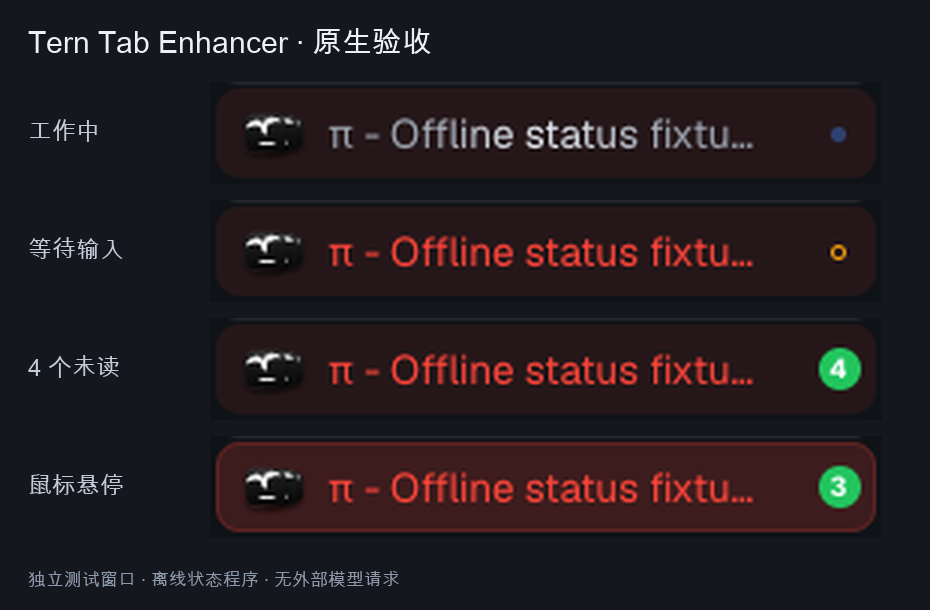

# Tern Tab Enhancer

[](https://github.com/404KSG/tern-tab-enhancer/actions/workflows/check.yml)

给 Tern 原生标签增加三项增强：Tty7 风格的 Agent 状态与未读 pane 数，Dia 风格的整行手动配色，以及清理前方图标右下角的状态圆点。



## 使用效果

- 蓝点 `#3B82F6`：正在工作，按 Tty7 以半秒节奏轻微明暗变化。
- 琥珀色空心点 `#F59E0B`：等待输入。
- 绿点 `#22C55E`：本轮结束。存在未查看结果时变为绿色数字徽章，数字是 panes 数量；9 表示至少 9 个。
- 同一个 Tab 的优先级：等待输入 > 工作中 > 本轮结束 > 未开始。只有聚合状态为结束时显示未读数字。
- 查看一个 pane 只清除它自己的未读数。全部看过后保留小绿点，下一轮新结果会重新计数。绿点不表示验收通过。
- 原来的颜色菜单仍然可用：手动颜色显示为整行淡底色，hover 加深，选中加强；不再占用右侧状态位置。
- 前方图标保持堆叠，原来的角上状态点移除。横向和纵向标签使用同一套规则。

工作中的彩色标签使用同色扫光，避免原生灰白渐变盖掉手动配色。插件不关闭或改动原生标题动画的时序，不修改 `reduce_motion` 等原生偏好。系统开启减少动态效果时，插件自己的小圆点也停止脉冲。

## 安装与更新

公开仓库：[404KSG/tern-tab-enhancer](https://github.com/404KSG/tern-tab-enhancer)。安装器支持 macOS / Linux，需 Python 3.10+；Tern 的实际 UI 验证目前在 macOS 上完成。

```sh
git clone https://github.com/404KSG/tern-tab-enhancer.git
cd tern-tab-enhancer
```

也可以下载 [Releases](https://github.com/404KSG/tern-tab-enhancer/releases) 的运行包，解压后运行其中的 `scripts/install.py`。

在本地源码目录安装，不需要 Node 或 npm 作为运行时依赖：

```sh
python3 scripts/install.py
```

更新已安装的拷贝：

```sh
python3 scripts/install.py --force
```

安装器使用唯一打包清单，只复制运行文件、Pi 状态桥、安装工具、说明和许可，不会把开发依赖和测试产物复制进 Tern。写入前预检并备份；失败会回滚旧组件，未完全恢复时保留备份并明确报告。它另外在 Pi 的个人扩展目录放置一个小型状态桥，不修改 Pi 的设置或模型配置。**已打开的 Pi 会话请在空闲后执行 `/reload`，或重新启动 Pi。** 安装后检查：

```sh
tern plugin list --json
```

命令面板可以搜索：`暂停标签增强`、`恢复标签增强`、`刷新标签状态`、`查看标签状态健康`。

普通读取失败后会以最多 8 秒的间隔退避重试；过期指示会变淡，恢复后正常显示。Tern 自身的钩子超时禁用不等于普通异常，仍可能需要重新加载插件，健康命令不是对宿主禁用机制的修复。

完整卸载（包含 Pi 状态桥）：

```sh
python3 scripts/install.py --uninstall
```

只移除 Tern 侧也可运行 `tern plugin remove tern-tab-enhancer`；已加载的 Pi 状态桥会发现插件已移除并停止，不再写状态。因为插件从不改写原生颜色、标签名称或布局，暂停或卸载后自动恢复原生显示。Tern 会保留插件自己的已读记录；这不影响原生界面。

## 兼容性

Agent Block 使用 Tern 的原生状态接口。**在普通 shell 中运行的 Pi 使用附带状态桥**：监听 Pi 的 `agent_start`、最终 `agent_settled` 与 UI 提问的开始/结束，向 Tern 的插件数据目录写入有限状态。它不使用 shell 整个生命周期的 busy 标记猜测 Agent 是否在工作。

Pi 状态桥以 Pi 1.2.0 为验证目标，macOS 可自动发现默认 Tern 配置目录；Linux 需显式提供 `TERN_CONFIG_DIR`。它只在 Tern 中的交互模式启用；print/JSON/RPC 子进程不能覆盖父会话状态。正常退出清理状态，意外终止后心跳超时约 15 秒停止显示旧状态。OMP/TSP 的支持范围取决于 Tern 自己报告的状态；没有状态通道的普通长命令不会被伪装成 Agent。

首要验证目标为 macOS 上的 Tern 0.9.0。当前验证见 [0.2.0 记录](docs/reports/reliability-0.2.0.md)，历史记录见[早期验证](docs/reports/verification.md)，行为约定见[设计文档](docs/design/tab-enhancement.md)。CSS 依赖 Tern 原生标签结构；Tern 改版后需复验。远程主机和其他系统不作未经测试的兼容承诺。

0.2.0 使用每 pane 独立状态与每轮只增的已读回执，避免一个窗口整表覆盖另一个窗口。共享同轮的读取合并有运行时测试；真实桌面双窗口验证的具体范围见记录，不能将两个窗口的独立会话等同为同一个 pane 的镜像。

Native 接口没有真正的轮次 ID：它依据工作状态观测及明确的完成事件记轮次，不把取消等待当成完成。短于采样间隔、完全没被观察到工作态的 Native 轮次仍有宿主信息边界；Pi 桥提供独立运行标识。

## 开发验证

Node 只用于运行真实 Luau 模块的行为测试：

```sh
npm ci --ignore-scripts
npm run check
```

GitHub CI 在 Linux / Node 22 和 24 上运行 Luau、Pi 桥、安装回滚和打包测试；它不冒充原生 UI 验收。

原生验收需要 macOS 的 Tern、Python 3 和 Pillow：

```sh
python3 scripts/verify_native.py
```

验收使用独立配置、独立 daemon 和独立窗口，通过离线状态程序测试真实 Tern 解析，并在普通 shell 中启动真实 Pi 1.2.0，使用本地离线 provider 验证工作、完成和提问恢复。不请求外部模型，不更改日常 Tern 设置；结束后关闭自己创建的进程。`artifacts/native/` 保留 JSON、截图、日志和清理结果。

## 发布与回滚

```sh
npm run package
```

发布包使用 `package-files.json`，附带 `SHA256SUMS.json`。版本变化见 [CHANGELOG](CHANGELOG.md)。若需回到上一版本，可在源码目录切到其 tag 后重新安装；原生设置和手动颜色始终不被改写：

```sh
git switch --detach v0.1.0
python3 scripts/install.py --force
```

## 本地数据与许可

运行时使用本机 pane/Agent 状态、插件 KV 和小型 Pi 状态文件：pane ID、随机运行标识、完成/已读记录、启用状态。状态暂时缺失不清除已读事实；每 pane 最多保留最近 8 个已读轮次回执，关闭 pane 时清理。不会向终端输入任务，不调用网络，不保存或展示聊天正文，不修改 Agent 认证或模型设置。Pi 状态桥只监听事件，不读取事件中的提问标题、用户提示或回答；每 5 秒发一次本地心跳。Tern 原生 Agent 接口可能附带最后一条消息，插件不使用该字段。

[MIT](LICENSE)。Tty7、Tern Tab Status 和用户提供的 Dia 截图的参考关系见[设计参考](THIRD_PARTY_NOTICES.md)。本插件独立于 Stencil、Tty7 和 Dia。
